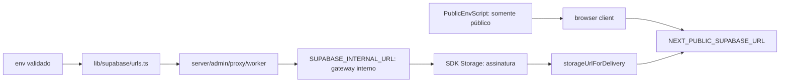

# Endereços do Supabase no self-host

Destino: núcleo. Contrato de implantação e transporte, sem tabelas ou nova tela.

`lib/supabase/urls.ts` resolve o transporte interno e reescreve somente URLs
Storage da origem/prefixo interno conhecido. Preserva path, encoding, query e
token. `storage-url.ts` aplica o env validado no servidor. Chamadores são os
redirects de avatar/mídia, download LGPD, imagem de template, notificação push,
e-mail LGPD e envio de mídia. A autorização de cada rota permanece anterior à
assinatura e os filtros de organização permanecem intactos.

Checklist de sistema vivo: entrada no env validado e no SDK, saída para os clients
e para a mídia exibida; o health check registra alcance sem revelar host ao
público; a foto/arquivo continua nas telas existentes; não há porta de navegação
nova. Falha de URL de configuração interrompe o boot com nome da variável; falha
de alcance aparece no health check e conduz à correção da configuração. Não há
trabalho assíncrono ou handoff novo neste adaptador. Mutação de negócio continua
auditada pelos handlers existentes; a tradução de endereço não cria nova mutação.

Provas locais: SDK real com transporte substituído para API keys antigas/novas;
redirect real de avatar mantendo tenant/cache; health interno sem exposição;
script público sem `SUPABASE_INTERNAL_URL`; URL com prefixo, token e escaping.
Login, refresh de sessão e transferência real de arquivo no VPS continuam como
aceitação de implantação, não são substituídos por esses testes unitários.

Uma URL pública de loopback no staging só funciona com túnel SSH no navegador.
Entregas para provedores externos requerem conectividade pública aprovada em
outra etapa; esta configuração não finge que a integração já está operacional.
